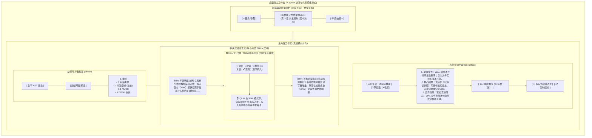
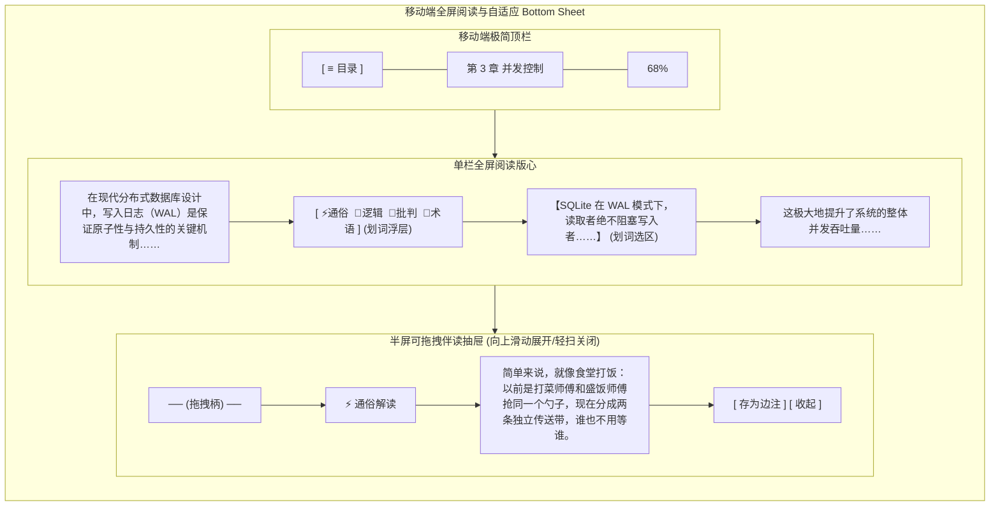

# 产品原型：AI Reader 极简沉浸式多端阅读工作台

- **功能**：AI Reader 极简沉浸式多端阅读工作台 (Flutter Multi-platform UI)
- **来源**：Agent 基于 iA Writer 设计哲学与用户对齐结论生成
- **介质**：Mermaid 交互线框原型 + 状态机流转图
- **关联 PRD**：`_02_product_design/ai_reader_full_feature_prd.md`
- **状态**：APPROVED (Frozen - Fully Aligned with iA Writer & 5-Platform Architecture)

---

## 1. 范围与非目标 (Scope & Non-Goals)

### 1.1 覆盖范围
1. **多端自适应布局**：支持 Windows、Linux、macOS、iOS、Android 5 端响应式适配；
2. **核心沉浸阅读区**：定宽黄金版心（680px~720px），支持长文平滑滚动、目录锚点跳转与段落精准对齐；
3. **段落级柔和失焦 (Focus Mode)**：聚焦段落保持 100% 清晰度，上下文段落平滑淡化至 65%，按 Esc/双击恢复；
4. **划词快速伴读胶囊**：原地轻量悬浮，直通 4 大认知模板（⚡️通俗、🔗逻辑、🧐批判、📖术语）与高亮标注；
5. **抽屉式认知伴读流**：桌面端右侧隐式侧栏/移动端 Bottom Sheet，流式展示思考链，支持**卡片内原位追问**并一键沉淀为 SQLite 边注；
6. **极简目录与思维导图**：轻量左侧栏，无感折叠，支持一键预览基于 AST 与 PMI 拓扑生成的知识全景树。

### 1.2 非目标
- 不做杂乱的社交分享、点赞、书评社区功能；
- 不在阅读主界面堆砌常驻编辑按钮、换行标尺与复杂格式刷；
- 移动端不做与桌面端完全一致的双侧常驻展开（移动端强制采用轻量抽屉与底部滑层）。

---

## 2. 主路径（核心阅读与伴读链路）

---

## 3. 屏布局线框（Mermaid Wireframes）

### 3.1 桌面端主工作台 (Desktop: macOS / Windows / Linux)

---

### 3.2 移动端竖屏布局 (Mobile: iOS / Android)

---

## 4. 与 PRD / DoD 映射关系 (Traceability Matrix)

| 原型组件与交互 | 关联 PRD 模块 | 核心能力与 DoD 验收标准 |
|---|---|---|
| **ReaderCanvas** (中央阅读版心) | F-01, F-02 | 统一呈现 AST 解析出的正文、章节与段落，准确高亮锚点与字符偏移量。 |
| **Floating Action Pill** (划词药丸) | F-04 | 选词/选句后毫秒级就绪，直达 4 套认知模板上下文装配。 |
| **RightCompanion** (伴读抽屉) | F-04 | 承载流式输出（TTFT < 800ms），断网时毫秒级呈现离线确定性启发卡。 |
| **TabMindmap** (导图与拓扑抽屉) | F-05, F-06 | 结合本地三级 NLP（TF-IDF + PMI 拓扑）与目录 AST 呈现层级导图树。 |
| **CompActions -> 存为边注** | F-03, F-07 | 增量原子写入本地 SQLite，将 AI 洞察持久化绑定在段落锚点。 |
| **5-Platform Responsive** | F-08 | 基于 Flutter 引擎，全平台统一六元组 FFI 桥接接入。 |
