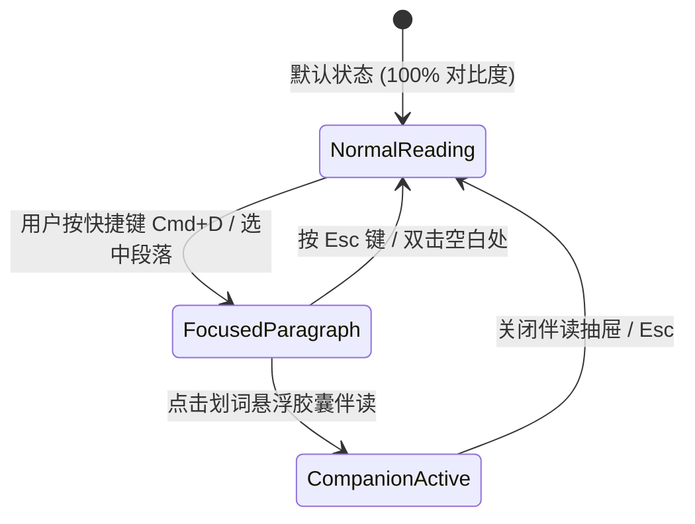

# 前端与客户端架构设计规范 (Flutter Feature-First)

- **模块名称**：客户端架构设计 (Client Layer Architecture)
- **架构方案**：T1 级按 Feature 划分的模块化架构 (Feature-First Architecture)
- **文档版本**：v1.0.0
- **日期**：2026-10-10
- **状态**：APPROVED

---

## 1. 架构总览与分层职责

Flutter 客户端解耦为三大核心层次：
1. **App Shell & Core Layer (`lib/core/`)**：
   - 全局主题（Light/Dark 遵循 `DESIGN.md`）、字体配置、跨平台适配器（Window/Screen Metrics）、本地 FFI 桥接客户端。
2. **Feature Modules (`lib/features/`)**：
   - **`document_reader/`**：核心沉浸阅读流、黄金版心定宽容器 (700px)、段落级柔和失焦 (Focus Mode) 状态管理、自动隐退顶栏。
   - **`floating_pill/`**：划词选区几何定位、悬浮快速伴读胶囊组件、4 大模板选择分发。
   - **`companion_drawer/`**：右侧流式伴读抽屉、Markdown 流式卡片组件、卡片内原位追问多轮会话控制器、边注保存交互。
   - **`mindmap_toc/`**：左侧 AST 目录树展示与全书 PMI 关键词概念拓扑导图。
   - **`mobile_bottom_sheet/`**：移动端专有手势拖拽半屏伴读滑层容器。
3. **Shared UI Kit (`lib/shared/`)**：
   - 极简无边框按钮、极细分割线、微微阴影卡片等基础排版控件（无业务规则）。

---

## 2. 跨语言 C-ABI FFI 桥接通信链路

```text
[Flutter UI Widget] 
       │ (用户划词点击 [⚡️通俗解读])
       ▼
[CompanionController (Riverpod/StateNotifier)]
       │ (构造 Request DTO)
       ▼
[ReaderEngineFFI (dart:ffi)]
       │ (跨语言指针调用 C-ABI: ai_reader_invoke)
       ▼
[reader_engine.py / Core Engine lib (.so / .dll / .dylib)]
       │ (执行 doc.parse / ai.companion_ask / annotation.save)
       ▼
[InvokeEnvelope JSON Payload]
       │ (返回统一信封: code, data, message, metrics)
       ▼
[Flutter UI Stream / View Model] (流式渲染 Markdown 卡片)
```

---

## 3. 核心交互状态机规范

### 3.1 聚焦模式状态机 (FocusModeState)


- **NormalReading**：全部段落不透明度为 100%；顶栏在鼠标移动时微弱可见，静止 3 秒后淡出。
- **FocusedParagraph**：当前焦点段落保持 100% 清晰度；所有非焦点段落透明度通过 `AnimatedOpacity(duration: 200ms)` 平滑过渡至 65%。
- **CompanionActive**：焦点段落保持 100%，非焦点段落 65%，右侧抽屉（桌面）或 Bottom Sheet（移动）滑出并流式接收回答。

---

## 4. 目录结构设计 (Flutter Project Layout)

```text
frontend/
  ├── pubspec.yaml
  ├── lib/
  │   ├── main.dart                      # 入口引导、自适应断点检测
  │   ├── core/
  │   │   ├── theme/                     # DESIGN.md 对应主题色与字形
  │   │   ├── ffi/                       # dart:ffi 绑定 (ai_reader_invoke)
  │   │   └── shortcuts/                 # 全局快捷键映射 (Cmd+D, Cmd+\)
  │   ├── features/
  │   │   ├── reader/                    # 沉浸阅读器与 Focus Mode
  │   │   │   ├── presentation/
  │   │   │   └── state/
  │   │   ├── selection_pill/            # 划词悬浮胶囊
  │   │   ├── companion/                 # 伴读抽屉与卡片内追问
  │   │   ├── toc_mindmap/               # 目录树与思维导图
  │   │   └── mobile_sheet/              # 移动端自适应 Bottom Sheet
  │   └── shared/                        # 极简排版组件
  └── test/
      └── unit/                          # 状态机与 FFI 编解码单元测试
```
