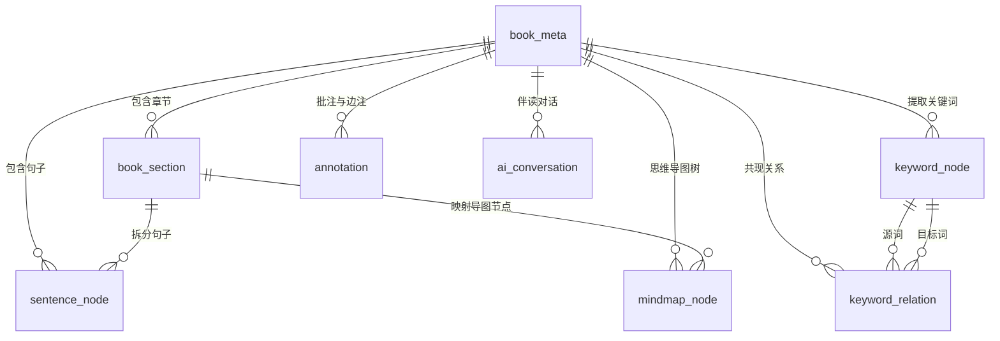

# AI Reader 核心数据库设计说明书 (DB Schema Design)

**文档编号**：DB-SCHEMA-001  
**生命周期阶段**：阶段 3 - 详细规格设计  
**编写时间**：2026-10-10  
**状态**：APPROVED  

---

## 1. 实体关系图 (ER Diagram)

---

## 2. 核心表结构规范与审计字段说明

所有表严格遵循 `hs-dev-skill` 标准审计字段规范，禁止使用任何保留字（如 `desc` 重命名为 `description`）：

1. **`book_meta` (书籍元数据)**：
   - 字段：`id`, `created_at`, `updated_at`, `description`, `is_del`, `version`, `title`, `author`, `file_path`, `file_hash`, `format`, `total_pages`, `read_progress`, `last_read_at`
2. **`book_section` (目录章节实体)**：
   - 字段：`id`, `created_at`, `updated_at`, `description`, `is_del`, `version`, `book_id`, `section_index`, `title`, `parent_id`, `start_page`, `end_page`, `content`
3. **`sentence_node` (句子级分析实体)**：
   - 字段：`id`, `created_at`, `updated_at`, `description`, `is_del`, `version`, `book_id`, `section_id`, `sentence_index`, `text`, `page_number`, `char_offset_start`, `char_offset_end`
4. **`keyword_node` (三级概念词实体)**：
   - 字段：`id`, `created_at`, `updated_at`, `description`, `is_del`, `version`, `book_id`, `word`, `level`, `tfidf_score`, `textrank_score`, `frequency`
5. **`keyword_relation` (关键词共现拓扑关系)**：
   - 字段：`id`, `created_at`, `updated_at`, `description`, `is_del`, `version`, `book_id`, `source_word_id`, `target_word_id`, `co_occurrence_count`, `pmi_score`, `weight`
6. **`mindmap_node` (思维导图树结构)**：
   - 字段：`id`, `created_at`, `updated_at`, `description`, `is_del`, `version`, `book_id`, `parent_id`, `title`, `section_id`, `level`, `sort_order`, `keywords_json`
7. **`annotation` (边注与富文本高亮)**：
   - 字段：`id`, `created_at`, `updated_at`, `description`, `is_del`, `version`, `book_id`, `section_id`, `color`, `style`, `note_text`, `anchor_json`, `ai_response`
8. **`ai_conversation` (AI伴读与认知模板历史)**：
   - 字段：`id`, `created_at`, `updated_at`, `description`, `is_del`, `version`, `book_id`, `section_id`, `template_type`, `prompt`, `response`, `latency_ms`

---

## 3. 迁移脚本管理

前向迁移脚本位于：[V1.0.0__init_reader_schema.sql](file:///home/hardstone/CodeSpace/GitHub/ai-reader/hs_dev_docs/_04_db_schema/_01_reader_core/migrations/V1.0.0__init_reader_schema.sql)  
回滚脚本位于：[U1.0.0__init_reader_schema.sql](file:///home/hardstone/CodeSpace/GitHub/ai-reader/hs_dev_docs/_04_db_schema/_01_reader_core/migrations/U1.0.0__init_reader_schema.sql)  
两个脚本版本完全匹配，支持原子部署与无损回滚。
