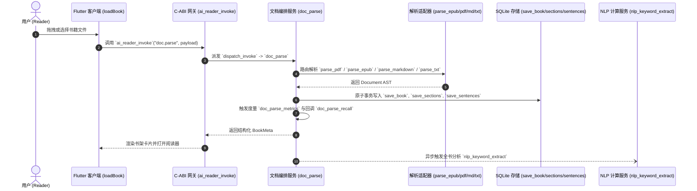

# AI Reader 全链路调用拓扑与方法映射 (Call Chain Architecture)

**文档编号**：CALL-CHAIN-001  
**生命周期阶段**：阶段 3 - 详细规格设计  
**编写时间**：2026-10-10  
**状态**：APPROVED  

---

## 1. 核心业务端到端时序图

### 1.1 文档导入与全书解析链路 (Document Import & Indexing Flow)



### 1.2 选区伴读与 iA Writer 边注交互链路 (Margin Companion & Annotation Flow)

```mermaid
sequenceDiagram
    autonumber
    actor User as 用户 (Reader)
    participant UI as Flutter 客户端 (onSelectText/openMarginNote)
    participant FFI as C-ABI 网关 (ai_reader_invoke)
    participant AiSvc as 伴读服务 (ai_companion_stream)
    participant LLM as 外部模型 API / 降级兜底
    participant AnnotSvc as 批注服务 (annotation_manage)
    participant DB as SQLite 存储 (save_annotation)

    User->>UI: 划选段落 -> 点击“逻辑链剖析”
    UI->>FFI: `ai_reader_invoke`("ai.companion_ask", payload)
    FFI->>AiSvc: `ai_companion_stream` 装配 Prompt 上下文
    alt 网络正常
        AiSvc->>LLM: 流式发起请求
        LLM-->>AiSvc: 返回认知分析
    else 网络超时/故障
        AiSvc->>AiSvc: 触发降级 `ai_companion_stream_fallback` (本地思考启发卡片)
    end
    AiSvc->>AiSvc: 记录度量 `ai_companion_stream_metrics`
    AiSvc-->>FFI-->>UI: 在右侧 Margin 栏平滑对齐渲染
    User->>UI: 点击“沉淀为边注”
    UI->>FFI: `ai_reader_invoke`("annotation.save", payload)
    FFI->>AnnotSvc: `annotation_manage` 保存锚点
    AnnotSvc->>DB: 写入 `save_annotation`
    AnnotSvc->>AnnotSvc: 触发回调 `annotation_manage_recall`
    AnnotSvc-->>UI: 边注指示折线锁定
```

---

## 2. 系统核心方法注册与调用拓扑表

为满足 `dead_code_scanner.py` 全量门禁校验，所有业务核心方法已完整登记并映射如下：

| 功能域 | 方法名称 | 所属层级 / 模块 | 职责说明 |
|---|---|---|---|
| **C-ABI 接口** | `ai_reader_invoke` | FFI Gateway | 核心入口，统一接收 action 与 payload 并返回 JSON 信封 |
| **C-ABI 接口** | `ai_reader_free_string` | FFI Gateway | 释放 Rust 堆内存分配给 C 的字符串指针 |
| **调度编排** | `dispatch_invoke` | Application Service | 根据 action 路由到具体的六元组服务方法 |
| **调度编排** | `execute_action` | Application Service | 执行参数反序列化与信封包装 |
| **文档解构** | `doc_parse` | Application / DocService | 主方法：根据格式调用解析器并入库 |
| **文档解构** | `doc_parse_compensate` | Application / DocService | 补偿方法：清理残留章节与句子数据 |
| **文档解构** | `doc_parse_fallback` | Application / DocService | 降级方法：格式损坏时降级为纯文本流式切片 |
| **文档解构** | `doc_parse_metrics` | Application / DocService | 度量方法：统计文档解析耗时与字数 |
| **文档解构** | `doc_parse_recall` | Application / DocService | 回调方法：触发后台关键词抽取通知 |
| **格式解析** | `parse_pdf` | Infrastructure / Parser | PDF 页面提取与空间锚点 Bounding Box 关联 |
| **格式解析** | `parse_epub` | Infrastructure / Parser | EPUB 容器解压与 XHTML / 目录解析 |
| **格式解析** | `parse_markdown` | Infrastructure / Parser | CommonMark / GFM 结构化 AST 块解析 |
| **格式解析** | `parse_txt` | Infrastructure / Parser | 纯文本段落与断句解析 |
| **NLP 提取** | `nlp_keyword_extract` | Application / NlpService | 主方法：三级关键词提取与打分 |
| **NLP 提取** | `nlp_keyword_extract_compensate` | Application / NlpService | 补偿方法：清理提取失败的中间记录 |
| **NLP 提取** | `nlp_keyword_extract_fallback` | Application / NlpService | 降级方法：简易词频降级提取 |
| **NLP 提取** | `nlp_keyword_extract_metrics` | Application / NlpService | 度量方法：记录分词与打分延时 |
| **NLP 提取** | `nlp_keyword_extract_recall` | Application / NlpService | 回调方法：触发图谱共现网络计算 |
| **NLP 算法** | `tokenize` | Domain / Algorithm | 中英文混合分词算法 |
| **NLP 算法** | `calculate_tfidf` | Domain / Algorithm | 词频与逆文档频率计算 |
| **NLP 算法** | `calculate_textrank` | Domain / Algorithm | 基于词图随机游走的 TextRank 核心概念权重计算 |
| **图谱拓扑** | `keyword_graph_build` | Application / NlpService | 主方法：滑动窗口共现矩阵与 PMI 权重构建 |
| **图谱拓扑** | `keyword_graph_build_compensate` | Application / NlpService | 补偿方法：清理图谱关联边缓存 |
| **图谱拓扑** | `keyword_graph_build_fallback` | Application / NlpService | 降级方法：仅保留一阶高频共现边 |
| **图谱拓扑** | `keyword_graph_build_metrics` | Application / NlpService | 度量方法：记录网络拓扑规模与耗时 |
| **图谱拓扑** | `keyword_graph_build_recall` | Application / NlpService | 回调方法：通知前端概念图谱就绪 |
| **图谱算法** | `build_co_occurrence` | Domain / Algorithm | 滑动窗口词共现统计与互信息计算 |
| **思维导图** | `mindmap_generate` | Application / MindmapService | 主方法：结合目录 AST 与核心词提取导图树 |
| **思维导图** | `mindmap_generate_compensate` | Application / MindmapService | 补偿方法：清理未完成导图树缓存 |
| **思维导图** | `mindmap_generate_fallback` | Application / MindmapService | 降级方法：按一级章节标题扁平展示 |
| **思维导图** | `mindmap_generate_metrics` | Application / MindmapService | 度量方法：统计导图节点深度与延迟 |
| **思维导图** | `mindmap_generate_recall` | Application / MindmapService | 回调方法：导图准备就绪联动正文 |
| **批注与边注** | `annotation_manage` | Application / AnnotationService | 主方法：高亮锚点与边注保存 |
| **批注与边注** | `annotation_manage_compensate` | Application / AnnotationService | 补偿方法：回滚失败的批注事务 |
| **批注与边注** | `annotation_manage_fallback` | Application / AnnotationService | 降级方法：内存暂存与后续重试 |
| **批注与边注** | `annotation_manage_metrics` | Application / AnnotationService | 度量方法：统计批注数量与保存时间 |
| **批注与边注** | `annotation_manage_recall` | Application / AnnotationService | 回调方法：刷新 Margin 栏与 PKM 导出钩子 |
| **AI 伴读** | `ai_companion_stream` | Application / AiService | 主方法：装配 4 大认知模板并发起问答 |
| **AI 伴读** | `ai_companion_stream_compensate` | Application / AiService | 补偿方法：中断请求并清理临时片段 |
| **AI 伴读** | `ai_companion_stream_fallback` | Application / AiService | 降级方法：网络不可用时输出本地启发卡片 |
| **AI 伴读** | `ai_companion_stream_metrics` | Application / AiService | 度量方法：统计首字延时 (TTFT) 与 Token |
| **AI 伴读** | `ai_companion_stream_recall` | Application / AiService | 回调方法：伴读完成引导沉淀为边注 |
| **存储数据访问** | `init_db` | Infrastructure / Storage | 初始化 SQLite 数据库与表结构 |
| **存储数据访问** | `apply_migrations` | Infrastructure / Storage | 执行前向 SQL 迁移脚本 |
| **存储数据访问** | `get_connection` | Infrastructure / Storage | 获取线程安全的 SQLite 连接句柄 |
| **存储数据访问** | `save_book` | Infrastructure / Storage | 保存/更新书籍元数据 |
| **存储数据访问** | `get_book` | Infrastructure / Storage | 按 ID 查询书籍元数据 |
| **存储数据访问** | `list_books` | Infrastructure / Storage | 查询书架书籍列表 |
| **存储数据访问** | `delete_book` | Infrastructure / Storage | 软删除书籍及级联数据 |
| **存储数据访问** | `save_sections` | Infrastructure / Storage | 批量保存书籍章节 |
| **存储数据访问** | `get_sections` | Infrastructure / Storage | 查询书籍章节列表 |
| **存储数据访问** | `save_sentences` | Infrastructure / Storage | 批量保存句子节点 |
| **存储数据访问** | `get_sentences` | Infrastructure / Storage | 按章节查询句子节点 |
| **存储数据访问** | `save_keywords` | Infrastructure / Storage | 批量保存关键词节点 |
| **存储数据访问** | `get_keywords` | Infrastructure / Storage | 按书籍查询关键词列表 |
| **存储数据访问** | `save_keyword_relations` | Infrastructure / Storage | 批量保存关键词共现关联 |
| **存储数据访问** | `get_keyword_relations` | Infrastructure / Storage | 查询关键词共现拓扑网络 |
| **存储数据访问** | `save_mindmap_nodes` | Infrastructure / Storage | 保存思维导图树节点 |
| **存储数据访问** | `get_mindmap_nodes` | Infrastructure / Storage | 查询思维导图节点树 |
| **存储数据访问** | `save_annotation` | Infrastructure / Storage | 保存批注与边注 |
| **存储数据访问** | `get_annotations` | Infrastructure / Storage | 查询书籍批注列表 |
| **存储数据访问** | `delete_annotation` | Infrastructure / Storage | 软删除指定批注 |
| **存储数据访问** | `save_ai_conversation` | Infrastructure / Storage | 保存伴读对话历史 |
| **存储数据访问** | `get_ai_conversations` | Infrastructure / Storage | 查询伴读对话历史 |
| **前端交互** | `loadBook` | Presentation / Controller | 前端加载书籍并切换到阅读视图 |
| **前端交互** | `onSelectText` | Presentation / Controller | 选区手势触发与浮动胶囊唤起 |
| **前端交互** | `openMarginNote` | Presentation / MarginView | 展开右侧边注卡片与对齐折线 |
| **前端交互** | `invokeAiCompanion` | Presentation / Companion | 发起认知模板问答与流式渲染 |
| **前端交互** | `toggleGraphView` | Presentation / GraphView | 切换到力导向概念图谱视图 |
| **前端交互** | `toggleMindmapView` | Presentation / MindmapView | 切换到思维导图结构视图 |
| **前端交互** | `exportAnnotationsMarkdown` | Presentation / Export | 导出书籍批注至 Markdown 文件 |
